<p align="center">
  
</p>

<h1 align="center">LAURA Food Donation</h1>

<p align="center"><strong>LAU Libraries · Creative Space</strong><br>Interactive food-donation NGO map of Lebanon</p>

<p align="center"><a href="https://lau-libraries-creative-space.github.io/laura-ngo-map/"><strong>Open the interactive review app</strong></a></p>

---

## About the project

An interactive map that helps individuals, caterers, wedding planners and event organizers find NGOs across Lebanon that may receive surplus food. The directory brings together the list compiled by the Department of Nutrition and Food Science at the Lebanese American University.

This is the supplied **v1.4 review version**, prepared for Dr. Rana Rizk and the NFS team. The app’s final name and wording remain open for review.

## Explore the map

- Browse **59 active NGOs** in a 3D terrain atlas or a detailed street map.
- Search by organization or area, and filter the directory.
- View NGO details, available contact information, directions and published reception-hour information.
- Save organizations in the current browser and share links to individual NGO entries.
- Explore regional shortcuts and daylight, golden-hour and moonlight themes.

The review website opens directly in a browser. No download or GitHub account is needed to explore the public app.

## Review with Dr. Rana

| Review area | Feedback requested |
| --- | --- |
| App name | Recommend a clear final name for the initiative. |
| Wording | Review headings, instructions, labels and descriptions. |
| NGO information | Confirm exact locations, contact details and reception information. |
| User experience | Suggest changes to the layout, filters and map interactions. |

The directory was revised on **19 November 2026** using the supplied NFS location updates. It contains **59 active NGOs**, **47 supplied or researched address pins** and **12 approximate pins**. Three entries marked for removal and one reported as non-operational were excluded. Some supplied pins differ from their original source area or identify more than one branch; these discrepancies are noted in the NGO details. Donors must call the NGO to confirm the exact receiving premises.

Contact the receiving NGO to confirm its location, current capacity, accepted food and delivery arrangements.

## Terms and responsibilities

The directory notice and complete [Terms of Use and Disclaimer](https://lau-libraries-creative-space.github.io/laura-ngo-map/terms.html) use the supplied wording. LAU is an information provider only; listed NGOs are independent. The source document recommends LAU legal-office review of the final wording.

## Current review scope

The 3D map now retains the pin touched on pointer-down, keeps labels stable through a tap and distinguishes taps from drags and pinches. Phone styles provide larger targets, a full-width scrolling NGO detail panel and readable contact/notice text.

The requested update removes NGO-specific illustrations, fridge indicators and filters, donation preparation/recording tools, and directory downloads. The app retains its current working name and displays “Last updated version 2026.”

Foundations wishing to be added can contact **[Nfs@lau.edu.lb](mailto:Nfs@lau.edu.lb)** through the listing-request section at the bottom of the app. The directory and NGO detail panels ask visitors to call the foundation directly for clarification.

**Shared estimated visitor tracking is enabled.** A browser is counted once using browser storage; the “Refresh count” button only reads the shared total. Clearing browser data or using another browser may add another visit. Donation records are never used as visitor counts. See [visitor tracking](docs/visitor-tracking.md) for the service, privacy and accuracy details.

## Collaboration and credits

| Contribution | Team |
| --- | --- |
| Academic collaboration | Assistant Professor Rana Rizk; Professor Hussein F. Hassan — Department of Nutrition and Food Science |
| Application design, development and implementation | Mohammad Al Touka — Creative Space Lab Assistant; School of Arts and Sciences, Computer Science Major |
| Concept design, creative direction and workflow development | Mr. Saad Salloum — Lead Creative Space Supervisor |
| Leadership | Mr. Hani Salem — Lead Library Technologies & Innovation Manager, University Libraries |
| Institutional support | Dr. Jordan Srour — Professor and Assistant Provost of Educational Resources and Innovation |

## Development and publication

The supplied application bundles are maintained in `app-source/`. The app uses React, Three.js and MapLibre GL. Node.js 22.12 or newer is required for the commands below; no dependency installation is needed to build the retained bundles.

```sh
npm run build
npm run preview
```

The local preview opens at `http://127.0.0.1:47864/`. From a source checkout, build once before using `START LAURA NGO MAP.bat`; packaged Windows releases already include the built assets.

Pushes to `main` run the GitHub Pages workflow. It reads the repository’s actual base path and publishes the static review build. For a manual build:

```sh
npm run build:github -- /laura-ngo-map/
```

See [GitHub publication details](DEPLOY-TO-GITHUB.md) for the workflow. Each Pages build publishes a content-versioned module graph so the app loads the updated scripts and styles. Street-map tiles require an internet connection; terrain, boundaries, NGO data and the LAU logo are bundled with the app.

---

**LAU Libraries – Creative Space**  
Lebanese American University  
© 2026 Lebanese American University. All Rights Reserved.
